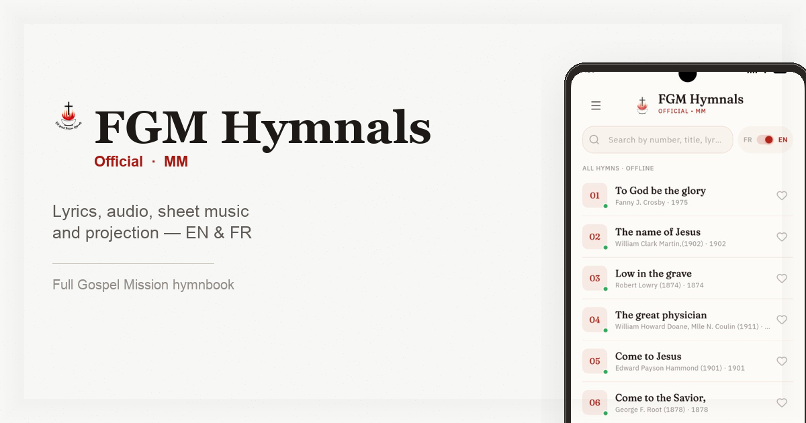
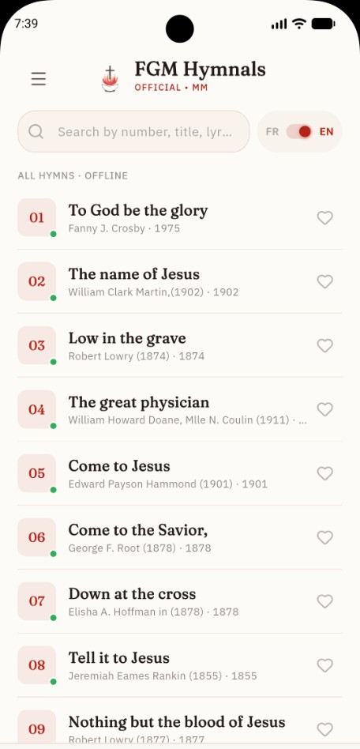

# FGM Hymnals — site

**Public page for the official Full Gospel Mission hymnbook.**
Page de présentation de l’application : paroles, audio, partitions et projection, en français et en anglais.

**Live:** [fgm-hymnals-web.vercel.app](https://fgm-hymnals-web.vercel.app)

The mobile app (Flutter, in-app purchase, offline hymn cache) stays in a private repository. This repository is the marketing site: the story of the product, store badges, and the screens people see before they install.

## Stack

Static HTML and CSS, deployed on Vercel. Open Graph image and store badges live in `public/`.

## Author

Paul Mbou — [github.com/paul-mbou](https://github.com/paul-mbou)
